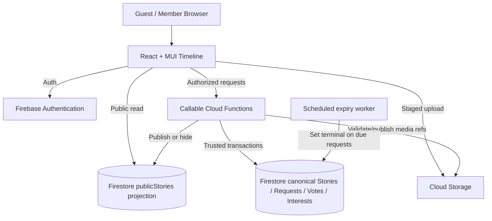
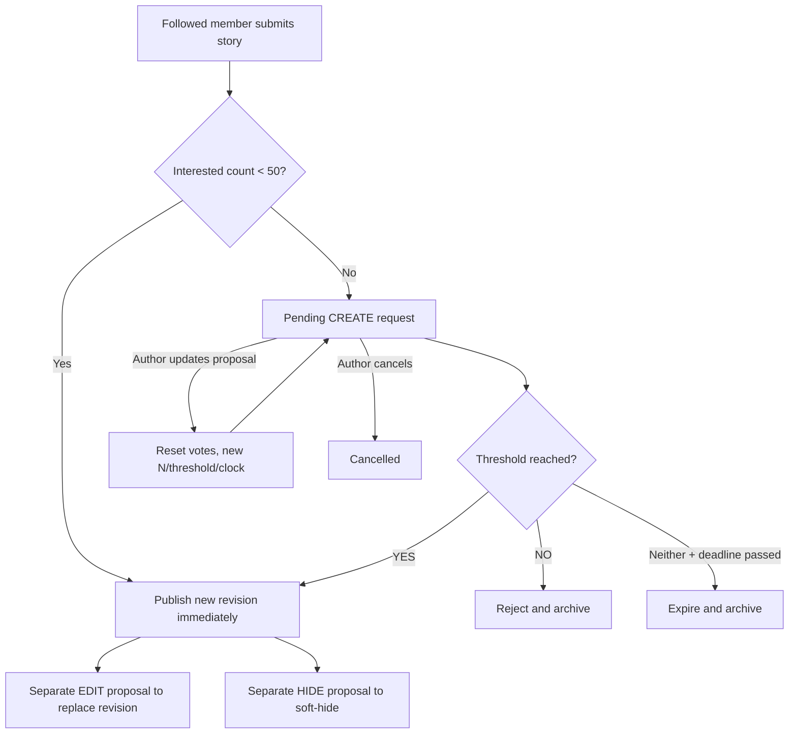

# 14 — Suggested Architecture Diagrams

## Data and public projection

## Story request transitions

Mermaid is conceptual; backend Firestore transaction and rules are still required. A frontend-drawn graph does not implement server security or exactness.
