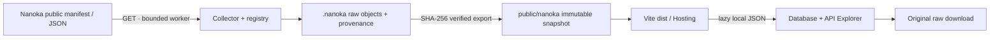

# Sayari — ฐานข้อมูล Zenless Zone Zero จาก Nanoka

เปิด `/game/zenless-zone-zero/database` หรือเลือก **ฐานข้อมูล Zenless Zone Zero** จาก Home ส่วนเครื่องคำนวณเดิมอยู่ `/game/zenless-zone-zero` พื้นหลังหลักของเว็บไซต์เป็นสีดำ

หน้า Database ใช้ snapshot ของข้อมูลเกมสาธารณะจาก [Nanoka ZZZ](https://zzz.nanoka.cc/) เป็นหลัก และเพิ่มภาษาไทยจาก [ZenlessData](https://git.mero.moe/dimbreath/ZenlessData) เฉพาะ ID/คีย์ที่ตรวจยืนยันแล้ว ค่าเริ่มต้นเป็นภาษาไทย เปลี่ยนเป็น English และจำค่าจาก Settings ได้ ข้อมูลที่ยังแปลไม่ได้ใช้ Nanoka English ค่าตัวเลขและ Raw ยังคงใช้ Nanoka เท่านั้น ไม่ใช้ข้อมูลผู้เล่น UID หรือข้อมูลที่ต้องล็อกอิน

คู่มือและรายงานปัจจุบันของชั้นภาษาไทยอยู่ [THAI_LOCALIZATION_SUMMARY_TH.md](THAI_LOCALIZATION_SUMMARY_TH.md) มีรายละเอียด source version/revision, mapping, sync, coverage และผลตรวจ แยกจาก pipeline Nanoka ด้านล่าง

## โครงสร้างและขอบเขต

- `src/features/nanoka/`: types, adapters, local snapshot client, request guards และ structured/raw renderers
- `src/views/games/zenless-zone-zero/database/`: หน้า Database, API Explorer และ CSS ที่จำกัดขอบเขตเฉพาะหน้านี้
- `tools/nanoka/`: collector, exporter, registry ส่วนขยาย, tests และตัวช่วย discovery
- `.nanoka/`: raw cache และรายงานแต่ละรอบ sync ซึ่งไม่ส่งขึ้น Git
- `public/nanoka/current.json`: pointer ไป snapshot ที่เผยแพร่ใน checkout นี้
- `public/nanoka/snapshots/<runId>/`: catalog, coverage และ JSON ต้นฉบับตาม SHA-256 โหลดเมื่อเปิดใช้งาน ไม่ import เข้า JavaScript bundle
- `evidence/nanoka-zzz/<timestamp>/`: หลักฐานจริงของงาน แยกจาก fixture tests

ค่าเริ่มต้นคือ distinct Live/Latest จาก `https://static.nanoka.cc/manifest.json` และภาษา `en`, `ja`, `ko`, `zh` ที่ตรวจพบจากเว็บจริง เวอร์ชันเก่าปรากฏเป็น “ยังไม่ได้ดาวน์โหลด” และต้องเลือก sync เพิ่มอย่างชัดเจน

Registry มีหมวดหลัก Agent, W-Engine, Bangboo, Drive Disc, item index และหมวดที่ตรวจพบเพิ่มเติม เช่น Monster, Achievement, Shiyu Defense, Deadly Assault, Threshold Simulation, Annihilation Simulacrum, Hollow ทั้ง 4 ชุด, item full records, noun, season maps และ version diff ข้อมูลที่อยู่รวมใน index ไม่สร้าง detail endpoint ขึ้นเอง

จำนวนที่ใช้อ้างอิงต้องอ่านจาก catalog ของรอบนั้น ไม่ hardcode จำนวนตัวละครหรือเลขเวอร์ชัน การดึงครบ registry ไม่ได้พิสูจน์ว่ารู้ทุก private/hidden endpoint ของผู้ให้บริการ

## เปิดใช้งานและตรวจโค้ด

ใช้ Node 20 ขึ้นไป (งานนี้ตรวจด้วย Node 22.14.0) และ npm จาก root ของโปรเจกต์:

```powershell
npm.cmd ci
npm.cmd run dev
npm.cmd run nanoka:check
```

คำสั่งสุดท้ายรัน unit tests, production build และ lint พร้อมเก็บผลไว้ใน evidence directory การสร้าง dist รวม JSON snapshot ที่มีอยู่ใน `public/` แล้ว

การตรวจ browser ใช้ dependency แยกจากแอป และใช้ Edge headless หนึ่งตัวต่อครั้ง:

```powershell
npm.cmd ci --prefix tools/nanoka/tools/network-discovery
node tools/nanoka/tools/network-discovery/browser-tests.mjs
node tools/nanoka/tools/network-discovery/browser-edge-tests.mjs
```

ค่าเริ่มต้นของ browser tests คือ `http://127.0.0.1:5174` เปลี่ยนได้ด้วย `$env:SAYARI_TEST_ORIGIN` เช่น preview ที่ `http://127.0.0.1:4173` ต้องเปิด server ก่อนรัน ชุด edge tests inject ข้อมูลสังเคราะห์และ transport errors เฉพาะ browser context ไม่เขียนลง `public/` และไม่นับเป็น live verification

## อัปเดตข้อมูล

รันทีละขั้นจาก root และใช้ collector เพียง instance เดียวต่อ `.nanoka` เดียวกัน:

```powershell
npm.cmd run nanoka:probe -- --refresh
npm.cmd run nanoka:sync
npm.cmd run nanoka:verify-manifest
npm.cmd run nanoka:export
npm.cmd run nanoka:audit
npm.cmd run nanoka:check
```

1. Probe อ่าน manifest/index ใหม่เพื่อคำนวณ ID และคำขอจริง ตรวจ `coverage.json`, `plan.json`, `requests.jsonl` ใน `.nanoka/runs/<runId>/` ก่อนเดินต่อ
2. Sync ดึง detail ทุก ID และทุกภาษาที่เลือก พร้อม reuse raw cache ที่ตรวจ hash แล้ว ค่าเริ่มต้นหนึ่ง worker, ระยะห่างเริ่มคำขอ 500ms, timeout 25 วินาที, ไม่เกิน 3 attempts, budget 6,000 requests และ body ไม่เกิน 32 MiB ข้อจำกัดนี้เป็นค่าฝั่ง Sayari ไม่ใช่อัตราที่ Nanoka ประกาศ
3. Verify-manifest ขอ manifest แบบ fresh หนึ่งครั้งและตรวจว่า Live/Latest ยังตรงกับรอบ sync ถ้าเปลี่ยนให้ sync ขอบเขตใหม่ก่อนสรุปว่าพร้อม
4. Export ตรวจ raw hash ทุกไฟล์ก่อนเปลี่ยน pointer และปฏิเสธ probe/partial โดยค่าเริ่มต้น `--allow-partial` มีไว้สำหรับการวินิจฉัยที่ระบุชัดเจนเท่านั้น Catalog ของ run ที่เผยแพร่แล้วแก้ทับไม่ได้
5. Audit ตรวจ raw bytes, ทุก ID, locale/version provenance และทุก leaf path โดยใช้ adapter ของแอป รายการ path เต็มเก็บเป็น gzip JSON แยกตาม hash และมี index ใน `FIELD_COVERAGE.json`

Cache ปกติใช้ได้ 24 ชั่วโมง `fetchedAt` หมายถึงเวลาที่ได้ body จากต้นทางจริง `cacheReadAt` แยกจากเวลานั้น ส่วน `sourceUpdatedAt` แสดง “ไม่ทราบ” หากต้นทางไม่มีข้อมูลที่ยืนยันได้ ปุ่ม refresh บนหน้าเว็บโหลด snapshot ที่เผยแพร่ใหม่เท่านั้น ไม่สั่ง sync upstream และไม่ทำให้ข้อมูลกลายเป็น real-time



ถ้าเจอ 401/403 ให้หยุด origin นั้น ถ้า 429 ให้เคารพ Retry-After และหยุดเมื่อไม่สำเร็จตาม budget ไม่ใช้ proxy, cookies ของผู้ใช้ หรือ alternate provider เพื่อเลี่ยงผลล้มเหลว ข้อมูลที่ล้มเหลวยังคงปรากฏใน coverage

## เมื่อ Nanoka เพิ่มหรือเปลี่ยนหมวด

ตัวช่วยอยู่ `tools/nanoka/tools/network-discovery/`:

```powershell
node tools/nanoka/tools/network-discovery/discover.mjs --out .nanoka/discovery --channel msedge --max-pages 40 --wait-ms 1800
node tools/nanoka/tools/network-discovery/review.mjs
node tools/nanoka/tools/network-discovery/review-selectors.mjs
```

ตรวจ Network, เมนู, tabs และ selectors ก่อนเพิ่ม `tools/nanoka/reference/extensions.json` ทุก endpoint ต้องมี source evidence ดึงทุก ID ตาม index ต่อด้วย full sync ไม่ใช้ detail ตัวอย่างเป็น roster และไม่ผูก framework payload ที่ไม่มีเวอร์ชันเข้ากับ Live โดยเดา

Discovery sign-off อยู่ `public/nanoka/discovery.json` และต้องอ้าง `runId` เดียวกับ pointer แอปไม่ยอมใช้ sign-off จากรอบเก่า ต้องจัดทำจากการตรวจจริงเมื่อขอบเขตเปลี่ยน ไม่สร้างสถานะผ่านอัตโนมัติจาก unit tests

## การอ่านข้อมูลและข้อจำกัด

เลือกหมวด/เวอร์ชัน/ภาษา ค้นหาชื่อหรือ ID และใช้ตัวกรองตามข้อมูลที่มี หน้ารายละเอียดมีส่วนอ่านง่าย ตัวเลือกสกิล/ระดับ และ structured tree ของข้อมูลทุกส่วน ค่า stat ใช้หน่วยและ scale ต้นฉบับ ไม่สร้างสูตรแปลงที่ยังไม่ตรวจสอบ

Unknown fields, `0`, `false`, `null`, ข้อความว่าง, `[]`, `{}` และ array ยาวยังเข้าถึงได้ด้วย recursive tree, pagination, field search และ raw download ทุก resource มี source URL, version/locale, fetch/cache time และ SHA-256 การดาวน์โหลดใช้ bytes ต้นฉบับ รวม BOM ถ้ามี ตัวเลขที่เกิน safe integer มีคำเตือนและต้องดู raw เพื่อค่าที่ exact

ไม่ inject HTML จากข้อมูลเกม ข้อความ markup ที่ไม่รู้จักแสดงเป็นข้อความ ภาพโหลดแบบ lazy จาก CDN ที่ตรวจ mapping แล้ว หากภาพไม่สำเร็จชื่อและการเปิด record ยังใช้งานได้ ไม่ mirror ภาพทั้ง CDN

Firebase Hosting มี rewrite เฉพาะเส้นทางเกม และ cache headers แยก pointer กับ immutable snapshots ตาม [เอกสาร Firebase Hosting](https://firebase.google.com/docs/hosting/full-config) งานนี้ไม่ deploy หรือทดสอบ production URL ให้ถือผล preview/emulator ตามหลักฐานที่ระบุในรายงานเท่านั้น

ไฟล์สรุปเก่า `SAYARI_PROJECT_SUMMARY.txt`, `audit-evidence.json`, `verification-results.json` คงไว้เป็นประวัติของรอบก่อน รายงานปัจจุบันของงาน Nanoka อยู่ใน evidence directory และ `docs/NANOKA_IMPLEMENTATION_SUMMARY_TH.md`

Git attributes กำหนดให้ raw JSON objects, original source evidence และ kit ต้นฉบับไม่ผ่านการแปลง LF/CRLF เพื่อให้ SHA-256 คงเดิมหลัง checkout บน Windows หาก Windows ล็อก pointer ต่อเนื่อง ให้หยุด dev/preview instance ที่เปิดไฟล์นั้นก่อน export แล้วเปิดใหม่ ตัว writer มี bounded retry และคง pointer เดิมเมื่อ atomic replace ไม่สำเร็จ
